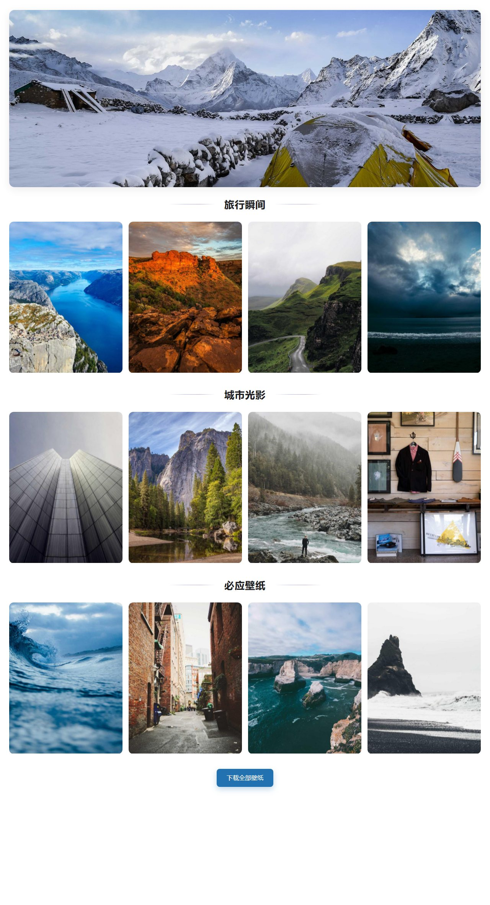

# 图片墙插件 (WP Photo Wall)

一个极简风格的图片墙 WordPress 插件，带有强大的后台管理和极致的前端性能优化。

## 页面预览

<p align="center">
  <a href="./screenshot-preview-pc-photowall.jpg"></a>
</p>

## ✨ 特性

- **极简设计**: 采用极简风格的 UI 设计，清爽、现代。
- **必应壁纸**: 自动拉取最近 7 天必应壁纸。
- **强大的后台管理**:
    - **三标签页布局**：
    - **分组管理**：创建多个分组，通过拖拽或批量选择移动图片到目标分组。
    - **分组排序**：拖动分组标题左侧抓手图标，即可调整分组在前台的展示顺序。
    - **批量操作**：支持批量移动分组、批量移除、从媒体库永久删除。
    - **删除二次确认**：所有删除操作均有确认弹窗。
    - **孤儿图片自动清理**：删除媒体库图片并保存后，若该图片已不被插件任何位置引用，将自动从媒体库永久删除，避免孤儿文件堆积。
    - **未保存提醒**：任意设置项被改动后都会标记为「未保存」，站内跳转或关闭页面时弹出提醒，未点击保存则不会发生任何改动。
- **极致性能优化**:
    - **后台**: 缩略图由 PHP 端一次性预加载，消除 N+1 AJAX 请求；批量 DOM 更新。
    - **前台**:
        - **异步解码 (`decoding="async"`)**：防止大图解码阻塞主线程。
        - **智能可见性 (`content-visibility`)**：只渲染视口内的图片，极大降低内存占用。
        - **懒加载 (`loading="lazy"`)**：提升首屏加载速度。
        - **滚动节流**：滚动时自动禁用 hover 动画，提升移动端流畅度。
        - **淡入动画**：图片加载时带有错落的淡入效果，视觉体验流畅优雅。
- **响应式布局**: 自动适应桌面、平板和手机。
- **内置灯箱 (Lightbox)**: 自带轻量级灯箱效果，支持键盘左右切换、焦点陷阱。
- **顶部海报轮播 (Banner Carousel)**: 支持本地媒体库与外部链接（最多 6 张）。

## 📁 项目结构

```
photo-wall/
├── wp-photo-wall.php          # 主入口文件（精简加载器）
├── includes/
│   ├── i18n.php               # 多语言翻译定义
│   ├── data.php               # 数据操作与校验
│   ├── ajax.php               # AJAX 请求处理
│   ├── frontend.php           # 前端渲染与短代码
│   ├── slides.php             # 顶部轮播数据层与渲染
│   └── bing.php               # 必应壁纸数据层（接口拉取 / 缓存 / 排序）
├── admin/
│   ├── admin-page.php         # 后台页面模板（含标签页导航）
│   ├── admin-slides.php       # 后台轮播管理模板（"首页海报"标签页）
│   ├── admin-bing.php         # 后台必应壁纸模板（"必应壁纸"标签页）
│   ├── admin-script.js        # 后台交互逻辑（标签切换、拖拽、媒体库）
│   └── admin-style.css        # 后台样式
├── public/
│   ├── shortcode.php          # 短代码输出模板
│   ├── gallery-script.js      # 前台交互（灯箱、无限滚动）
│   ├── gallery-style.css      # 前台样式
│   ├── slider-script.js       # 前台轮播交互（自动播放、滑动、悬停暂停）
│   └── slider-style.css       # 前台轮播样式
├── uninstall.php              # 卸载清理
└── README.md
```

## 📥 安装

1. 下载插件压缩包（`photo-wall-3.0.0.zip`）。
2. 在 WordPress 后台 → **插件** → **安装插件**。
3. 点击 **上传插件**，选择 zip 文件并安装。
4. 启用插件。

## 🚀 使用方法

在 WordPress 后台侧边栏找到 **"图片墙"** 菜单。
- **首页海报**：管理展示的海报轮播。
- **图片管理**：管理图片墙的图片、分组以及常规设置。
- **必应壁纸**：配置接口并预览/排序最近 7 天的必应壁纸。

### 1. 图片管理 - 添加图片

切换到 **"图片管理"** 标签页：

- 点击 **"选择/上传图片"** 从媒体库选择。
- 点击 **"添加外部链接"** 输入图片 URL。
- 新添加的图片默认放入"未分组"。

### 2. 图片管理 - 分组管理

- 在图片管理区域顶部输入名称，点击 **"添加分组"** 创建新分组。
- **拖拽图片**：直接拖动图片到目标分组。
- **批量移动**：勾选图片 → 点击"移动选中"按钮 → 在弹窗中选择目标分组 → 确认。
- **调整分组顺序**：拖动分组标题左侧的 ≡ 图标。
- 所有操作需要点击 **"保存更改"** 才会生效。

### 3. 图片管理 - 删除图片

- 点击图片右下角的 **×** 移除单张图片；勾选多张后点击 **"批量删除选中"** 批量移除；**"清空所有"** 会清空整个图片墙。
- **外部链接图片**：仅解除引用，源站图片不受影响。
- **媒体库图片**：保存后会**同步从媒体库永久删除**（不可恢复）；若该图片仍被顶部轮播等其他位置引用，则会保留以免图片失效。
- 每次删除都会弹出二次确认，说明影响并要求点击 **"保存更改"** 才生效；**未保存时刷新页面即恢复原状**，服务器不会有任何改动。

### 4. 在页面显示

在任意页面或文章中使用短代码：

```
[photo_wall]
```

> 图片必须移动到一个已创建的分组后才会显示在前台；"未分组"是后台暂存区，不会公开显示。

同一页面可以放置多个 `[photo_wall]`，每个实例的分页和灯箱状态彼此独立。每个实例的顶部轮播也相互独立（共用同一组选图配置，各自独立播放）。

### 5. 首页海报 - 顶部海报轮播

切换到 **"首页海报"** 标签页，即可管理顶部海报轮播：

- 勾选 **"启用轮播"** 后，会显示自动轮播。
- 点击 **"从媒体库添加"** 选择本地图片，或 **"添加外部链接"** 输入图片 URL。
- **最多 6 张**：达到上限后无法继续添加，会弹出提示；工具栏右侧实时显示"已添加 x / 6"。
- 拖动图片左上角的抓手图标可调整轮播顺序。
- 设置 **"轮播间隔"**（秒）与 **"点击打开灯箱"** 开关。
- 本标签页底部自带 **"保存更改"** 按钮，无需切回"图片管理"标签页。

### 6. 必应壁纸

切换到 **"必应壁纸"** 标签页：

- **启用**：勾选后在前端显示必应壁纸分组。
- **API 接口地址**：默认使用必应官方接口（无需 Key）：
    ```
    https://www.bing.com/HPImageArchive.aspx?format=js&idx=0&n=7&mkt=zh-CN
    ```
    可替换为任意兼容的 JSON 接口，输入框下方「接口返回格式要求」列出了完整格式说明（数组层级、字段含义、排序规则、直链要求与最小示例）。

    接口需满足：GET 请求返回 JSON，壁纸数组放在 `images` / `data` / `list` / `results` / `wallpapers` 任一字段下（或直接返回数组），每条至少包含 `url`；可选 `urlbase`（用于生成缩略图）、`startdate`（`YYYYMMDD`，用于排序与记忆拖拽顺序）、`title`、`copyright`。只取前 7 条，成功结果缓存 6 小时。
- **前端分组标题**：默认"必应壁纸"，可自定义。
- **下载按钮**：可自定义**按钮链接**与**按钮名称**（留空则不显示按钮）。
  **仅适用于必应壁纸**：关闭必应壁纸、暂未拉到壁纸或链接留空时，前端均不会显示该按钮。
- **自动更新**：默认开启，每天**凌晨 1:00**（站点时区）自动拉取一次最新壁纸，可在下拉框改为任意整点。基于 WP-Cron；如需精确执行请配置系统级 crontab（每 5 分钟请求 `wp-cron.php`）。
  页面会显示"下次执行"与"上次自动拉取"时间，方便确认是否按预期运行。
- **重新拉取**：立即请求接口刷新（结果默认缓存 6 小时）。
- **排序**：默认按时间倒序（最新在前），拖动缩略图可自定义顺序，点击 **"恢复时间排序"** 还原。

前端展示规则：

- 没有任何自定义分组时，**只显示必应壁纸**。
- 有自定义分组时，必应壁纸作为**最后一个分组**追加显示。

### 7. 前端功能

- 悬停图片会有轻微上浮效果。
- 点击图片进入全屏灯箱模式。
- 滚动到底部会自动加载更多。
- 灯箱支持键盘导航（←→切换，Esc 关闭）。

### 8. 图片管理 - 设置选项

- **启用灯箱**：可关闭内置灯箱（适用于主题已有灯箱的情况）。
- **下载按钮链接**：配置外部网盘下载地址，前台显示下载入口。
- **顶部海报轮播**：启用/禁用轮播、设置自动播放间隔。
- **孤儿图片自动清理**：本插件已内置、无需额外设置。

## 📋 系统要求

- WordPress 6.0+
- PHP 7.4+

## 🔄 更新日志

### 3.0.0
- **重磅升级**：**全新现代化后台 UI** 
- **首页海报重构**：
  - 双栏交互设计，左侧配置轮播开关、时间间隔微调、灯箱开关及图片列表卡片。
  - 右侧集成**实时轮播效果预览（Live Preview）**组件，所见即所得。
- **图片管理重构**：
  - 升级为**左侧分组侧栏 + 右侧图片画廊**的 Master-Detail 双栏管理模式。
  - 新增**即时图片搜索与过滤**功能（按文件名/链接秒级检索）。
  - 支持**网格视图与列表视图**自由切换。
- **必应壁纸重构**：
  - 统一现代 Switch 开关交互与“已启用/已关闭”状态反馈胶囊。
  - 新增 **API 接口与下载链接一键测试（测试连接）** 异步检测能力。
  - 增强定时任务执行时间直观选择与状态展示。
- **全局体验优化**：
  - 新增**固定底部操作栏（Sticky Bottom Bar）**，改动时实时显示警示状态与快捷保存。
  - 新增全局轻量 Toast 消息提示组件。
  - 统一错误与空状态反馈，升级多端响应式排版。

## 📜 许可证

GPL v2 or later
